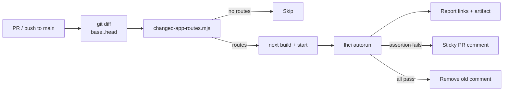

<div align="center">

# Lighthouse for changed Next.js routes

**Run Lighthouse CI only on the App Router pages your change touches.**<br>
No full-site audits on every push, no hand-kept URL lists.

[](https://github.com/Fivlas/lighthouse-workflow/actions/workflows/lighthouse-changed-routes.yml)


[Preview](#preview) · [Setup](#setup) · [How it works](#how-it-works) · [Agent prompt](#agent-prompt)

</div>

---

## Preview

See the workflow running on real pull requests in this repo:

| PR | What it changes | What to look at |
| --- | --- | --- |
| [#2: Add `/test` page](https://github.com/Fivlas/lighthouse-workflow/pull/2) | One new page | Exactly one route (`/test`) gets audited |
| [#3: Add example App Router routes](https://github.com/Fivlas/lighthouse-workflow/pull/3) | Route groups, `[slug]`, `[...slug]`, `[[...filters]]`, `@stats` slot, `(.)photo` interception, `_private` folder | Only the static routes get audited; dynamic and private ones are skipped |

Open a PR's **Checks** tab → *Audit changed Next.js routes* → **Detect changed routes** to see the route list, and **Run Lighthouse** for the report links.

## Setup

### 1. Copy two files into your Next.js project

```text
.github/workflows/lighthouse-changed-routes.yml
scripts/changed-app-routes.mjs
```

```bash
# from the root of your project
mkdir -p .github/workflows scripts
curl -fsSL https://raw.githubusercontent.com/Fivlas/lighthouse-workflow/main/.github/workflows/lighthouse-changed-routes.yml \
  -o .github/workflows/lighthouse-changed-routes.yml
curl -fsSL https://raw.githubusercontent.com/Fivlas/lighthouse-workflow/main/scripts/changed-app-routes.mjs \
  -o scripts/changed-app-routes.mjs
```

### 2. Check your project matches

- [x] Uses the **App Router** in `app/` or `src/app/`
- [x] `package.json` has `build` and `start` scripts
- [x] `package-lock.json` is committed (the workflow runs `npm ci`)
- [x] The app serves on port `3000` after `npm run start`
- [x] Default branch is `main`, or you've edited the `branches:` filters

### 3. (Optional) Add GitHub status checks

Install the [Lighthouse CI GitHub App](https://github.com/apps/lighthouse-ci) on the repo, then add the token it gives you as a repository secret named **`LHCI_GITHUB_APP_TOKEN`** (*Settings → Secrets and variables → Actions*). Without it the workflow still runs. You just don't get the per-URL status checks.

### 4. Open a pull request

Touch any page and open a PR against `main`. That's it.

> [!IMPORTANT]
> Reports go to Lighthouse's **temporary public storage**: anyone with the link can view them, and they expire after a few days. A copy is also kept as the `lighthouse-changed-routes` workflow artifact. Don't use this on pages that show private data.

> [!NOTE]
> PRs from forks get a read-only `GITHUB_TOKEN`, so the failure comment can't be posted there. The audit itself still runs.

## How it works



**Triggers:** pull requests to `main`, pushes to `main`, and manual runs (`workflow_dispatch`, which compares `HEAD` with the merge base of the default branch). A new run on the same PR or branch cancels the one in progress.

### Which routes get audited

The script reads `app/`, or `src/app/` if there's no `app/`.

| Changed file | Routes audited |
| --- | --- |
| `page.(tsx\|ts\|jsx\|js\|mdx\|md)` | That page |
| `layout` · `template` · `loading` · `error` · `global-error` · `not-found` · `default` | Every page in that folder and below |
| Any other file in the app folder (components, CSS, utils) | Every page |
| Files outside the app folder | None |

| URL rule | Example | Result |
| --- | --- | --- |
| Route groups are stripped | `app/(marketing)/about/page.tsx` | `/about` |
| Parallel slots map to the parent | `app/dashboard/@stats/page.tsx` | `/dashboard` |
| Interception prefixes are stripped | `app/feed/(.)photo/page.tsx` | `/feed/photo` |
| Dynamic routes are skipped | `app/blog/[slug]/page.tsx` | — |
| Private folders are skipped | `app/_private/page.tsx` | — |
| Deleted pages are skipped | (file no longer exists) | — |

Dynamic routes are skipped because there's no real URL to visit without param values.

### Thresholds

| Category | Min score | On failure |
| --- | --- | --- |
| Accessibility | 0.9 | ❌ **Fails the job** and posts a PR comment |
| Performance | 0.8 | ⚠️ Warning |
| Best practices | 0.9 | ⚠️ Warning |
| SEO | 0.9 | ⚠️ Warning |

Edit the `assertions` block in the **Configure Lighthouse CI** step to change them.

### PR comment

When an assertion fails, the workflow posts one sticky comment with a table of failed audits (URL, audit, actual vs expected) and links to each report. It updates that same comment on later pushes and deletes it once the audit passes.

## Test route detection locally

```bash
git diff --name-only main > changed-files.txt
node scripts/changed-app-routes.mjs changed-files.txt routes.json
cat routes.json   # e.g. ["/about","/pricing"]
```

## Agent prompt

Paste this into Claude Code, Cursor, Copilot or any coding agent working in **your** Next.js repo:

<details>
<summary><b>Show prompt</b></summary>

```text
Add a GitHub Actions workflow that runs Lighthouse CI only on the Next.js App Router
routes changed in a PR. Use https://github.com/Fivlas/lighthouse-workflow as the reference.

1. Download these two files into this repo, unchanged:
   - https://raw.githubusercontent.com/Fivlas/lighthouse-workflow/main/.github/workflows/lighthouse-changed-routes.yml
     -> .github/workflows/lighthouse-changed-routes.yml
   - https://raw.githubusercontent.com/Fivlas/lighthouse-workflow/main/scripts/changed-app-routes.mjs
     -> scripts/changed-app-routes.mjs

2. Check this repo against the workflow's assumptions and adapt only what doesn't match:
   - App Router lives in app/ or src/app/ (the script supports both).
   - package.json has "build" and "start" scripts.
   - Package manager: the workflow uses `npm ci` with a package-lock.json. If this repo
     uses pnpm, yarn or bun (check the lockfile), change the setup-node cache, install,
     build and start commands to that package manager.
   - The app serves on http://localhost:3000 after the start command. If not, update the
     readiness check and the URLs in "Configure Lighthouse CI".
   - The default branch. Update the `branches:` filters if it isn't `main`.
   - Required env vars for `next build`/`next start`. If the build needs any, list them
     for me and add placeholder `env:` entries that read from repository secrets.

3. Verify locally:
   - Run `npm run build` (or the equivalent) and confirm it succeeds.
   - Run: git diff --name-only <default-branch> > /tmp/changed.txt &&
          node scripts/changed-app-routes.mjs /tmp/changed.txt /tmp/routes.json
     and show me the detected routes.

4. Don't commit. Summarize what you changed, and tell me:
   - that the optional LHCI_GITHUB_APP_TOKEN secret enables status checks
     (https://github.com/apps/lighthouse-ci),
   - that reports are uploaded to Lighthouse's temporary public storage, so they're
     publicly viewable by link.
```

</details>

## Run this demo app

```bash
npm install
npm run dev
```

Open [http://localhost:3000](http://localhost:3000).
